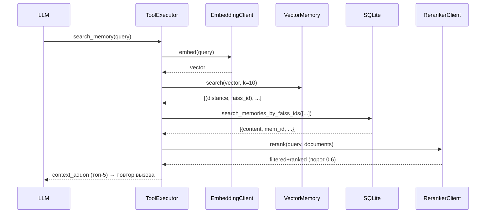

# Система памяти (Memory System)

Система памяти Милы состоит из трёх уровней:

1. **Векторная память** (FAISS) — быстрый поиск по семантической близости
2. **SQLite memories** — долгосрочные факты о пользователях
3. **Автобиографическая память** — собственные знания Милы о себе (используется ночью, в дневной промпт не инжектится — см. [persona.md](persona.md))

## 1. Векторная память (FAISS)

**Файл**: `core/memory/vector.py`

### Класс `VectorMemory`

```python
class VectorMemory:
    def __init__(self, index_path: str, dim: int)
```

- FAISS `IndexFlatL2` + `IndexIDMap` (прямой доступ по ID)
- L2-дистанция для поиска ближайших соседей
- Размерность: `EMBED_DIM` из config (**по умолчанию 384**, напр. nomic-embed-text; должна совпадать с моделью эмбеддингов)
- В `MilaUserbot`: `VectorMemory(settings.FAISS_TEXT_PATH, dim=settings.EMBED_DIM)`, т.е. файл **`data/faiss_text.index`** (плюс зарезервированный `FAISS_IMAGE_PATH = data/faiss_image.index`, пока не используется)

### Операции

| Метод | Описание |
|-------|----------|
| `load_or_create()` | Загружает индекс из файла или создаёт новый (вызывается в `__init__`) |
| `add(vectors, ids)` | Добавляет векторы с указанными ID (`add_with_ids`, float32/int64) |
| `search(query_vector, k=5)` | Поиск k ближайших; возвращает `(distances[0], indices[0])` |
| `save()` | Сохраняет индекс, только если `ntotal > 0` |
| `rebuild_from_active(active_ids, all_vectors)` | Перестроение индекса (после удаления записей) |

### Периодическое сохранение

В `MilaUserbot.periodic_save()` — каждые `FAISS_SAVE_INTERVAL_MIN` минут (по умолчанию 10). Сохраняет только текстовый индекс.

## 2. SQLite Memories

**Файл**: `core/db.py` (таблица `memories`). Актуальная схема (TEXT-идентификаторы, UUID):

```sql
CREATE TABLE memories (
    mem_id TEXT PRIMARY KEY,          -- uuid4
    user_id TEXT NOT NULL,
    faiss_id INTEGER,                 -- связь с FAISS (может быть NULL)
    type TEXT DEFAULT 'fact',
    tag TEXT,                         -- JSON (поле называется tag, не tags)
    content TEXT,
    importance REAL DEFAULT 0.5,
    confidence_source TEXT DEFAULT 'llm_extraction',
    confidence_verified INTEGER DEFAULT 0,
    last_accessed_at TEXT,
    time TEXT DEFAULT (datetime('now')),
    source_chat_id TEXT,
    source_message_id TEXT
);
```

Полей `is_active / access_count / created_at / updated_at / confidence` **нет** — это устаревшие имена из старой документации.

### Основные операции

| Функция | Описание |
|---------|----------|
| `add_memory(user_id, content, importance, tags, source_chat_id, source_message_id, faiss_id)` | Создание записи (возвращает `mem_id`); эмбеддинг+FAISS делает вызывающий код/Observatory, не сама функция |
| `search_memories_by_ids(mem_ids)` | Загрузка по `mem_id` |
| `search_memories_by_faiss_ids(faiss_ids)` | Загрузка по FAISS ID (пустой вход → `[]`) |
| `update_memory_access(mem_ids)` | Обновление `last_accessed_at` (без счётчиков) |

### Интеграция с FAISS



## 3. Автобиографическая память Милы

**Файл**: `core/memory/eternal.py`

Таблица `mila_memory_chunks` создаётся **лениво** в `eternal._ensure_table()` (не в `init_db()`):

```sql
CREATE TABLE mila_memory_chunks (
    chunk_id TEXT PRIMARY KEY,        -- uuid4, не INTEGER id
    title TEXT NOT NULL,
    content_md TEXT NOT NULL,
    created_at TEXT DEFAULT (datetime('now')),
    updated_at TEXT DEFAULT (datetime('now')),
    version INTEGER DEFAULT 1,        -- +1 при каждом update
    is_active INTEGER DEFAULT 1,      -- мягкое удаление
    importance REAL DEFAULT 0.5
);
```

### API

| Функция | Описание |
|---------|----------|
| `add_chunk(title, content_md, importance)` | Добавить чанк → возвращает `chunk_id` (str) |
| `update_chunk(chunk_id, title?, content_md?, importance?)` | Обновить (версия +1), `False` если не найден |
| `deactivate_chunk(chunk_id)` | Мягкое удаление (`is_active=0`) |
| `get_all_active_chunks()` | Все активные чанки |
| `get_chunk(chunk_id)` | Один чанк |
| `get_chunks_metadata()` | Метаданные (без content) |
| `get_all_chunks_markdown()` | Полный markdown-документ |
| `get_chunk_count()` | Количество активных чанков |

### Использование

> Важно: вопреки старым версиям документации, `persona.py` **не** инжектит `get_all_chunks_markdown()` в дневной system prompt. Чанки читает/меняет ночная рефлексия (`process_diary_analysis`, двухстадийная проверка) со стейджингом и атомарным коммитом/откатом (см. [sleep-system.md](sleep-system.md)).

## 4. EmbeddingClient

**Файл**: `core/llm/embeddings.py`

Двухрежимный клиент:

- **Ollama**: POST `/api/embed` (определяется по порту 11434 или "ollama" в hostname)
- **OpenAI-compatible**: `openai.AsyncOpenAI.embeddings.create()`

Автоматическое определение + fallback между режимами при ошибке. `embed([query])` возвращает список векторов.

## 5. RerankerClient

**Файл**: `core/llm/reranker.py`

BGE-Reranker-v2-m3 через sentence-transformers `CrossEncoder`.

- Загружается лениво (при первом использовании)
- Порог фильтрации: `RERANKER_THRESHOLD = 0.6` (config.py)
- Путь модели: `RERANKER_MODEL_PATH = models/rerankers/BGE-Reranker-v2-m3`
- Установка: `python install_reranker.py` (HuggingFace `snapshot_download` репозитория `BAAI/bge-reranker-v2-m3` именно в этот путь)

## Настройки (config.py)

| Параметр | Значение по умолч. | Описание |
|----------|-------------------|----------|
| `EMBED_API_BASE` | (обязателен) | Базовый URL для эмбеддингов |
| `EMBED_API_KEY` | (обязателен) | API ключ |
| `EMBED_MODEL` | (обязателен) | Модель эмбеддингов |
| `EMBED_DIM` | `384` | Размерность (должна совпадать с моделью!) |
| `FAISS_TEXT_PATH` | `data/faiss_text.index` | Рабочий текстовый индекс |
| `FAISS_IMAGE_PATH` | `data/faiss_image.index` | Зарезервирован, не используется |
| `FAISS_SAVE_INTERVAL_MIN` | `10` | Интервал автосохранения |
| `RERANKER_MODEL_PATH` | `models/rerankers/BGE-Reranker-v2-m3` | Путь к реранкеру |
| `RERANKER_THRESHOLD` | `0.6` | Порог фильтрации |

Старого `FAISS_INDEX_PATH = data/faiss.index` и размерности 768 в коде нет.
