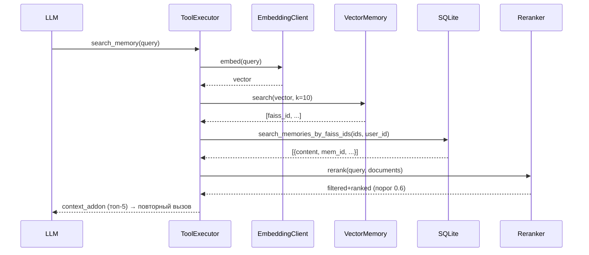

# Система памяти (Memory System)

Память Милы состоит из трёх уровней:

1. **Векторная память (FAISS)** — быстрый семантический поиск.
2. **SQLite `memories`** — долгосрочные факты о пользователях.
3. **Автобиографическая память** — собственные знания Милы о себе
   (`mila_memory_chunks`), используются ночью.

## 1. Векторная память (FAISS)

**Файл:** `core/memory/vector.py`

```python
VectorMemory(index_path: str, dim: int)
```

- FAISS `IndexFlatL2` + `IndexIDMap`;
- размерность `EMBED_DIM` (по умолчанию **384**);
- в боте: `VectorMemory(settings.FAISS_TEXT_PATH, dim=settings.EMBED_DIM)` —
  `data/faiss_text.index`;
- `data/faiss_image.index` зарезервирован, не используется.

### Операции

| Метод | Описание |
|-------|----------|
| `load_or_create()` | Загружает индекс или создаёт новый |
| `add(vectors, ids)` | `add_with_ids`, float32/int64 |
| `search(query_vector, k=5)` | `(distances[0], indices[0])` |
| `save()` | Атомарная запись через `.tmp` + `os.replace`, только при `ntotal > 0` |
| `rebuild_from_active(active_ids, all_vectors)` | Перестроение индекса |

### Отказоустойчивость

- повреждённый индекс при загрузке **не роняет процесс**: файл
  переименовывается в `*.corrupt-<timestamp>`, создаётся новый;
- сохранение защищено межпроцессным `flock` (`*.lock`) — bot и Observatory не
  перетирают файл;
- запись атомарная: падение посреди `save()` оставляет старый индекс целым.

### Периодическое сохранение

`MilaUserbot.periodic_save()` — каждые `FAISS_SAVE_INTERVAL_MIN` минут (10).
При `stop()` индекс сохраняется ещё раз.

## 2. SQLite Memories

**Файл:** `core/db.py`, таблица `memories` (TEXT UUID).

```sql
CREATE TABLE memories (
    mem_id TEXT PRIMARY KEY,          -- uuid4
    user_id TEXT NOT NULL,
    faiss_id INTEGER,                 -- связь с FAISS (может быть NULL)
    type TEXT DEFAULT 'fact',
    tag TEXT,                         -- JSON (поле tag, не tags)
    content TEXT,
    importance REAL DEFAULT 0.5,
    confidence_source TEXT DEFAULT 'llm_extraction',
    confidence_verified INTEGER DEFAULT 0,
    last_accessed_at TEXT,
    time TEXT DEFAULT (datetime('now')),
    source_chat_id TEXT,
    source_message_id TEXT
);
```

### Основные операции

| Функция | Описание |
|---------|----------|
| `add_memory(...)` | Создание записи, возвращает `mem_id`; эмбеддинг/FAISS делает вызывающий |
| `search_memories_by_ids(mem_ids)` | Загрузка по `mem_id` |
| `search_memories_by_faiss_ids(faiss_ids, user_id=None)` | Загрузка по FAISS ID; `user_id` обязателен для изоляции |
| `update_memory_access(mem_ids)` | Обновление `last_accessed_at` |

### Изоляция по пользователю

`ToolExecutor._handle_search_memory()` передаёт `user_id` в
`search_memories_by_faiss_ids()`. Legacy-строки с `NULL user_id` видны только
если per-user совпадений нет — это осознанный backward-compat, а не общий доступ.

### Интеграция с FAISS



## 3. Автобиографическая память Милы

**Файл:** `core/memory/eternal.py`

Таблица создаётся лениво `_ensure_table()`:

```sql
CREATE TABLE mila_memory_chunks (
    chunk_id TEXT PRIMARY KEY,        -- uuid4
    title TEXT NOT NULL,
    content_md TEXT NOT NULL,
    created_at TEXT DEFAULT (datetime('now')),
    updated_at TEXT DEFAULT (datetime('now')),
    version INTEGER DEFAULT 1,        -- +1 при update
    is_active INTEGER DEFAULT 1,      -- мягкое удаление
    importance REAL DEFAULT 0.5
);
```

### API

| Функция | Описание |
|---------|----------|
| `add_chunk(title, content_md, importance)` | Добавить → `chunk_id` |
| `update_chunk(chunk_id, title?, content_md?, importance?)` | Версия +1 |
| `deactivate_chunk(chunk_id)` | Мягкое удаление |
| `get_all_active_chunks()` | Все активные чанки |
| `get_chunk(chunk_id)` | Один чанк |
| `get_chunks_metadata()` | Метаданные без content |
| `get_all_chunks_markdown()` | Полный Markdown-документ |
| `get_chunk_count()` | Количество активных |

### Использование

`persona.py` **не** инжектит чанки в дневной prompt. Их читает и меняет ночная
рефлексия (`process_diary_analysis`) через staging + commit/rollback
(см. [sleep-system.md](sleep-system.md)).

## 4. EmbeddingClient

**Файл:** `core/llm/embeddings.py`

- **Ollama**: POST `/api/embed` (порт 11434 или `ollama` в hostname);
- **OpenAI-compatible**: `AsyncOpenAI.embeddings.create()`;
- порядок попыток зависит от URL; при ошибке — fallback на второй режим;
- OpenAI-путь делает до 3 попыток с backoff 1с/2с;
- `embed([text])` возвращает `np.ndarray`.

## 5. RerankerClient

**Файл:** `core/llm/reranker.py`

- BGE-Reranker-v2-m3 через `sentence_transformers.CrossEncoder`;
- загружается лениво при первом использовании;
- порог `RERANKER_THRESHOLD = 0.6`;
- путь `models/rerankers/BGE-Reranker-v2-m3`;
- установка: `python install_reranker.py`;
- если модели нет — конструктор бросает `FileNotFoundError`, поиск памяти
  вернёт `status: "error"`.

## 6. Медиа и память контекста

Фото/войсы хранятся не в FAISS, а как файлы + `chunks.media_path`.

- при входящем сообщении файл копируется в `MEDIA_DIR`;
- пайплайн повторно подключает последние 3 фото и 2 аудио к их сообщениям;
- после ночной суммаризации старых сообщений `detach_media_by_chunk_ids()`
  очищает `media_path`, а файлы (включая сконвертированный `.wav`) удаляются —
  чтобы старые фото/аудио не выглядели свежими в следующих ходах;
- текстовые плейсхолдеры и summary остаются.

## Настройки (`config.py`)

| Параметр | По умолч. | Описание |
|----------|-----------|----------|
| `EMBED_API_BASE` | обязателен | |
| `EMBED_API_KEY` | обязателен | |
| `EMBED_MODEL` | обязателен | |
| `EMBED_DIM` | `384` | Должна совпадать с моделью |
| `FAISS_TEXT_PATH` | `data/faiss_text.index` | Рабочий индекс |
| `FAISS_IMAGE_PATH` | `data/faiss_image.index` | Резерв |
| `FAISS_SAVE_INTERVAL_MIN` | `10` | Автосохранение |
| `RERANKER_MODEL_PATH` | `models/rerankers/BGE-Reranker-v2-m3` | |
| `RERANKER_THRESHOLD` | `0.6` | Порог |
| `MEDIA_DIR` | `data/media` | Файлы для истории |
| `MAX_MEDIA_MB` | `20` | Лимит скачивания |

Старых `FAISS_INDEX_PATH = data/faiss.index` и размерности 768 в коде нет.
