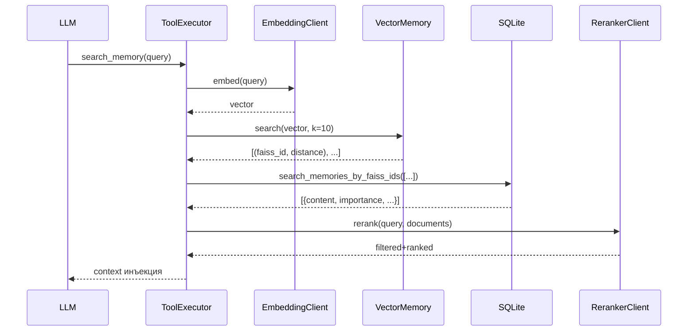

# Система памяти (Memory System)

Система памяти Милы состоит из трёх уровней:

1. **Векторная память** (FAISS) — быстрый поиск по семантической близости
2. **SQLite memories** — долгосрочные факты о пользователях
3. **Автобиографическая память** — собственные знания Милы о себе

## 1. Векторная память (FAISS)

**Файл**: `core/memory/vector.py`

### Класс `VectorMemory`

```python
class VectorMemory:
    def __init__(self, index_path: str, dim: int = 768)
```

- Использует FAISS `IndexFlatL2` + `IndexIDMap` для прямого доступа по ID
- L2-дистанция для поиска ближайших соседей
- Размерность эмбеддингов: 768 (по умолчанию, конфигурируется через `EMBED_DIM`)

### Операции

| Метод | Описание |
|-------|----------|
| `load_or_create()` | Загружает индекс из файла или создаёт новый |
| `add(vectors, ids)` | Добавляет векторы с указанными ID |
| `search(query_vector, k)` | Поиск k ближайших соседей |
| `save()` | Сохраняет индекс на диск |
| `rebuild_from_active(active_ids, all_vectors)` | Перестроение индекса (после удаления записей) |

### Периодическое сохранение

В `MilaUserbot.periodic_save()` — каждые N минут (настраивается в `FAISS_SAVE_INTERVAL_MIN`).

## 2. SQLite Memories

**Файл**: `core/db.py` (таблица `memories`)

### Схема

```sql
CREATE TABLE memories (
    id INTEGER PRIMARY KEY AUTOINCREMENT,
    faiss_id INTEGER UNIQUE,
    user_id INTEGER,
    content TEXT NOT NULL,
    importance REAL DEFAULT 0.5,
    confidence REAL DEFAULT 0.7,
    tags TEXT,                 -- JSON-массив
    source TEXT,               -- откуда получено
    is_active INTEGER DEFAULT 1,
    created_at TIMESTAMP,
    updated_at TIMESTAMP,
    last_accessed TIMESTAMP,
    access_count INTEGER DEFAULT 0
);
```

### Основные операции

| Функция | Описание |
|---------|----------|
| `add_memory(user_id, content, importance, tags, source, faiss_id)` | Создание + эмбеддинг + FAISS |
| `search_memories_by_ids(ids)` | Загрузка содержимого по ID |
| `search_memories_by_faiss_ids(faiss_ids)` | Загрузка содержимого по FAISS ID |
| `update_memory_access(memory_id)` | Обновление счётчика обращений |

### Интеграция с FAISS



## 3. Автобиографическая память Милы

**Файл**: `core/memory/eternal.py`

Таблица `mila_memory_chunks` в `mila.db`:

```sql
CREATE TABLE mila_memory_chunks (
    id INTEGER PRIMARY KEY AUTOINCREMENT,
    title TEXT NOT NULL,
    content_md TEXT NOT NULL,
    importance REAL DEFAULT 0.5,
    version INTEGER DEFAULT 1,
    is_active INTEGER DEFAULT 1,
    created_at TIMESTAMP,
    updated_at TIMESTAMP
);
```

### API

| Функция | Описание |
|---------|----------|
| `add_chunk(title, content_md, importance)` | Добавить чанк → возвращает chunk_id |
| `update_chunk(chunk_id, title, content_md, importance)` | Обновить (версия +1) |
| `deactivate_chunk(chunk_id)` | Мягкое удаление |
| `get_all_active_chunks()` | Все активные чанки |
| `get_chunk(chunk_id)` | Один чанк |
| `get_chunks_metadata()` | Метаданные (без content) |
| `get_all_chunks_markdown()` | Полный документ в формате markdown для инъекции в system prompt |
| `get_chunk_count()` | Количество активных чанков |

### Использование

В `persona.py` вся автобиографическая память инжектируется в system prompt:

```
[Твои воспоминания о себе]
{get_all_chunks_markdown()}
```

### Управление во сне

Ночная рефлексия может добавлять/обновлять/удалять чанки через двухстадийную LLM-проверку. Все изменения стейджатся и коммитятся атомарно.

## 4. EmbeddingClient

**Файл**: `core/llm/embeddings.py`

Двухрежимный клиент для получения эмбеддингов:

- **Ollama**: POST `/api/embed` (определяется по порту 11434 или "ollama" в hostname)
- **OpenAI-compatible**: `openai.AsyncOpenAI.embeddings.create()`

Автоматическое определение + fallback между режимами при ошибке.

## 5. RerankerClient

**Файл**: `core/llm/reranker.py`

BGE-Reranker-v2-m3 через sentence-transformers `CrossEncoder`.

- Загружается лениво (при первом использовании)
- Порог фильтрации: 0.6
- Модель скачивается через `python install_reranker.py` (HuggingFace snapshot_download)

## Настройки (config.py)

| Параметр | Описание |
|----------|----------|
| `EMBED_API_BASE` | Базовый URL для эмбеддингов |
| `EMBED_API_KEY` | API ключ |
| `EMBED_MODEL` | Модель эмбеддингов |
| `EMBED_DIM` | Размерность эмбеддингов (768) |
| `FAISS_INDEX_PATH` | Путь к FAISS индексу |
| `FAISS_SAVE_INTERVAL_MIN` | Интервал автосохранения |
